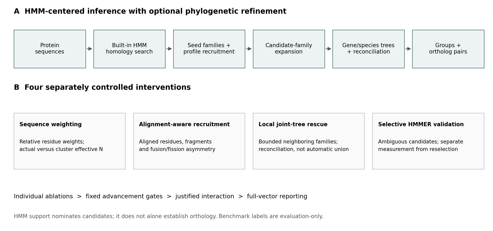
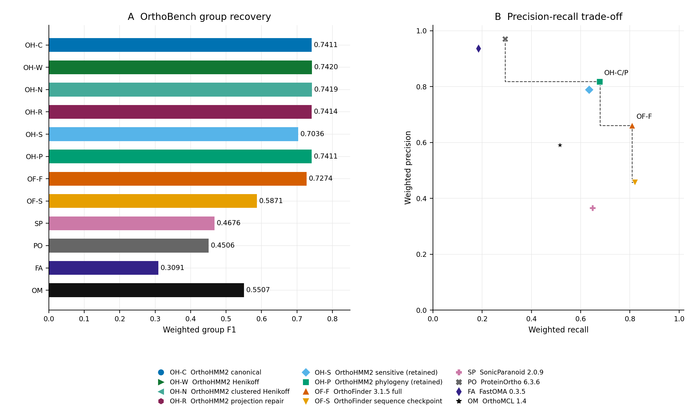
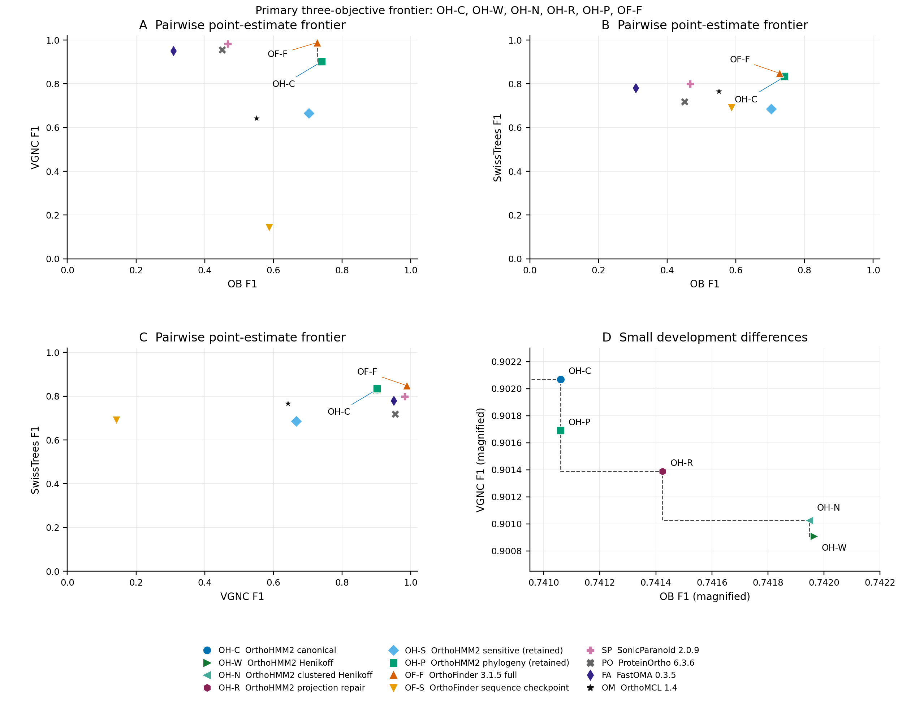
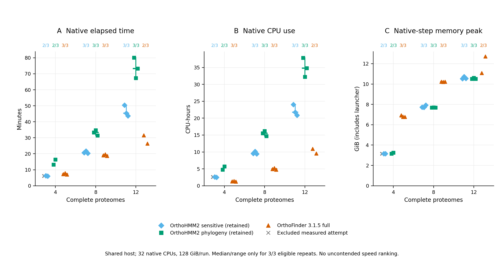
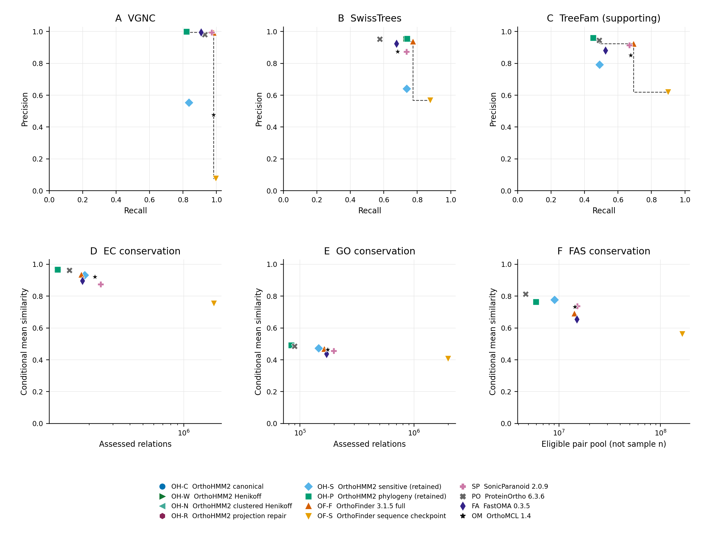
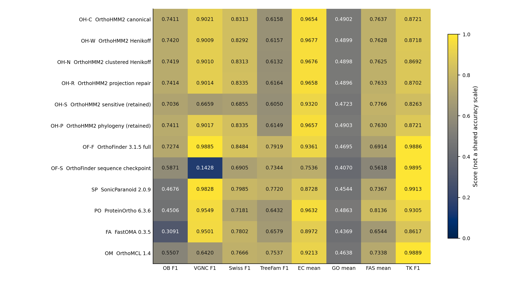
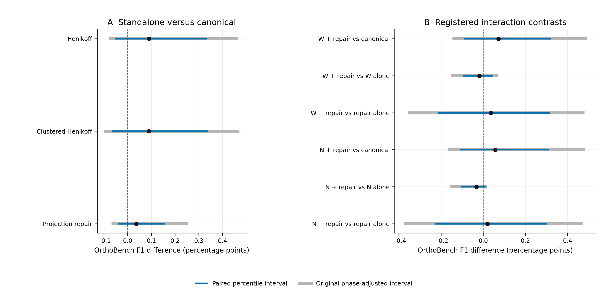

## Abstract

Orthology inference balances recovery of divergent homologs against separation
of paralogs, and different benchmarks emphasize different aspects of this
trade-off. OrthoHMM2, an HMM-centered inference workflow with phylogenetic
refinement, was evaluated against six comparator configurations using
OrthoBench, Quest for Orthologs (QfO), and a supplementary Three Kingdoms marker
reference. Controlled experiments tested sequence-weighted family profiles,
alignment-aware recruitment, local joint-tree rescue, and selective HMMER
validation. Canonical
OrthoHMM2 achieved OrthoBench F1 of 0.741061, compared with 0.727365 for full
OrthoFinder 3.1.5, through higher precision but lower recall. OrthoFinder had
higher VGNC, SwissTrees, and TreeFam-A F1. Among 12 complete-vector
configurations, five OrthoHMM2 configurations and full OrthoFinder were
nondominated on the three primary F1 objectives. This descriptive frontier
did not imply statistical superiority. Small standalone OrthoHMM2 improvements
had paired uncertainty intervals spanning zero, and both tested combinations
failed to improve on their weighting-only constituents. These results locate
OrthoHMM2 on a benchmark-dependent accuracy frontier while supporting unchanged
defaults rather than a universal accuracy or efficiency advantage.

## Introduction

Orthologs descend from speciation events, whereas paralogs descend from gene
duplication. Similarity is therefore evidence for homology, not sufficient
evidence for orthology. OrthoFinder integrates sequence comparison with
phylogenetic inference [@orthofinder2019; @orthofinder2026;
@orthofinder2026correction], while profile HMMs offer a complementary way to
represent family-level sequence conservation [@eddy2011]. The original OrthoHMM
preprint introduced an HMM-based orthogroup inference framework
[@orthohmm2024preprint]. OrthoHMM2 extends that framework with built-in HMM
search, family-profile recruitment, and optional phylogenetic refinement.
The present study evaluates this development implementation and controlled
alternatives, rather than reanalyzing the original preprint's implementation.

Group recovery, ortholog-pair recovery, and functional conservation measure
different properties of orthology predictions, which complicates comparisons
based on a single summary score. To distinguish these properties, the present
analysis locates OrthoHMM2 among the observed trade-offs using Pareto dominance.
A configuration is dominated
when another is at least as good on every specified objective and strictly
better on at least one. This definition makes both the chosen objectives and
the comparison set consequential. The primary comparison combines curated
group recovery with two QfO reference-pair tests, retaining functional
conservation and more limited reference panels as separate evidence.

## Results

### HMM-centered inference and controlled improvements

The workflow combines sequence-supported homology search, family-profile
recruitment, candidate-family expansion, and phylogenetic inference (Fig. 1).
Separate experiments evaluated position-based sequence weighting,
aligned-residue recruitment evidence, bounded local joint-tree rescue, and
HMMER remeasurement of ambiguous candidates before testing a combination of
weighting and projection repair. The controls separate profile construction, candidate generation,
score measurement, and decision-rule changes. An HMM match alone never
establishes orthology.

### OrthoHMM2 trades recall for precision on OrthoBench

Canonical OrthoHMM2 achieved weighted group F1 of 0.741061, precision 0.817705,
and recall 0.677553. Full OrthoFinder 3.1.5 achieved F1 of 0.727365, precision
0.660651, and recall 0.809066 (Fig. 2). Thus, the higher OrthoHMM2 F1 reflects
a precision-recall trade-off rather than uniform superiority. Henikoff
weighting reached the highest observed OrthoBench F1, 0.741965, but its
improvement over canonical was only 0.090379 percentage points. Clustered
Henikoff weighting and projection repair achieved 0.741947 and 0.741424,
respectively. These are experimental configurations, not newly recommended
defaults.

### The frontier depends on the evaluation objective

On the three primary objectives, OrthoBench, VGNC, and SwissTrees F1, six of
12 configurations were nondominated, comprising canonical OrthoHMM2, both retained
weighting variants, projection repair, retained phylogenetic OrthoHMM2, and full
OrthoFinder (Fig. 3; Supplementary Table S2). Five points represent OrthoHMM2
configurations, not five independent tools. Their frontier membership arises
from different compromises among benchmarks; it does not establish a single
best configuration.

The pairwise projections clarify this distinction. Full OrthoFinder was the
only nondominated configuration when VGNC and SwissTrees F1 were considered
together, exceeding every evaluated OrthoHMM2 configuration on both. Adding
OrthoBench introduces a competing objective and places OrthoHMM2 configurations
on the frontier. When supporting TreeFam-A and supplementary Three Kingdoms
F1 were added, nine configurations became nondominated, including the
sequence-only OrthoFinder checkpoint, SonicParanoid, and OrthoMCL. Frontier
membership is therefore sensitive to objective choice and cannot substitute
for biological interpretation or independent validation.

### Resource measurements are descriptive, not an efficiency frontier

The retained matched-resource panel reviewed 27 sequential attempts on nested
4-, 8-, and 12-proteome datasets. Twenty-five attempts produced measurements;
24 were eligible under the original review rules, and six of nine method/size
cells contained all three eligible repeats (Fig. 4). At eight proteomes,
median native elapsed times were 20.6 minutes for retained high-sensitivity
OrthoHMM2, 33.3 minutes for retained phylogenetic OrthoHMM2, and 19.0 minutes for
full OrthoFinder. These are shared-host observations with unknown,
potentially method-dependent contention. They do not establish isolated
speedups, asymptotic scaling, or costs of the new weighted configurations.
An accuracy-runtime frontier would require measurements from the same
configurations and cannot be inferred from cached incremental campaign costs.

### QfO separates orthology recovery from functional conservation

Full OrthoFinder had higher VGNC, SwissTrees, and TreeFam-A F1 than canonical
OrthoHMM2, with values of 0.988546 versus 0.902068, 0.848413 versus 0.831348, and 0.791918
versus 0.615778, respectively (Fig. 5; Supplementary Fig. S1). Canonical
OrthoHMM2 had higher EC, GO, and FAS conditional means of 0.965382, 0.490236,
and 0.763725, compared with 0.936130, 0.469548, and 0.691422 for full
OrthoFinder. These means summarize different assessed pair populations,
not matched-population accuracy effects. FAS eligibility counts are not its
numerical sample sizes. The supplementary Three Kingdoms result also favored
full OrthoFinder, 0.988582 versus 0.872133, but evaluates a restricted marker
reference rather than a genome-scale assessment of orthology.

### Profile refinement did not support a new default

The unadjusted paired OrthoBench F1 intervals for Henikoff, clustered
Henikoff, and projection repair included zero, spanning [-0.050123, 0.331771],
[-0.062645, 0.335866], and [-0.036216, 0.154189] percentage points
(Supplementary Fig. S2). Effects across benchmarks were mixed. Species-normalized
weighting and the strict alignment guard failed their original advancement
gates. Local rescue left all 70 reference-family scores unchanged. Both
builtin and HMMER anchor reselection exceeded the allowed recall loss;
HMMER measurement without reselection matched projection repair alone.

A registered six-arm weighting/projection experiment reproduced all four
constituent controls. Both combinations exceeded canonical F1 but fell below
their corresponding weighting-only controls, reaching 0.741784 versus 0.741965 and
0.741628 versus 0.741947. Neither advanced to QfO or Three Kingdoms. Failed
executions and unrun endpoints remain explicit in Supplementary Table S1 and
are not treated as negative biological results or zero scores.

## Discussion

OrthoHMM2 achieved higher precision and F1 but lower recall than full
OrthoFinder on OrthoBench, whereas full OrthoFinder had higher F1 on the
principal QfO reference-pair tests. These differences place both methods on
the frontier when OrthoBench and the primary QfO objectives are considered
together. Higher functional similarity among a smaller
or differently selected prediction set does not overturn that comparison.

Sequence weighting changed recruitment, but the observed gains did
not transfer uniformly. More restrictive alignment evidence can remove true
relationships, and more sensitive scoring does not ensure that anchor
reselection improves orthology. The failed combinations show that individually
promising changes need not be additive. Accordingly, production defaults remain
unchanged and the three standalone candidates remain experimental.

All primary panels were exposed during development. The frontier is a
descriptive reanalysis of those results, not independent confirmation or a
statistical test of superiority. Reference families can share evolutionary
history, and predicted groups can join families; bootstrap exchangeability
is therefore an approximation. TreeFam is supporting evidence, Three Kingdoms
is marker-limited, and functional annotations and FAS sampling impose further
population-selection limitations. No suitable strictly independent panel was
admitted after the candidate freeze. These limitations narrow the conclusions
without invalidating the controlled negative results.

## Methods

### Implementation and configurations

OrthoHMM2 names the development framework evaluated here. Historical run
identifiers retain their original OrthoHMM names and source revisions; this
naming does not designate a new released package version or a rerun of those
configurations.

Initial built-in search uses local maximum-path match/insert/delete scoring
with BLOSUM62 emissions and fixed transition costs. Its approximate
significance filter is not a demonstrated HMMER-calibrated E-value. Family
profiles learn match emissions from alignments while retaining uniform
transition costs; they are not equivalent to HMMER Plan7 profiles. Recruitment
requires member-score thresholds and sequence-supported anchors. Phylogenetic
refinement expands candidate families, infers alignments and trees, and
applies the recorded orthology/paralogy rules. The code and per-run bindings,
including parameter values and external commands, are retained in the
completed campaign archive; historical runs retain their own revisions.
Canonical denotes the experimental matched collection, not the shipping
default or the retained phylogeny result collection. New full-proteome
experiments used sequential 16-CPU/128-GiB allocations; the separate historical
resource panel used the 32-CPU allocations described below.

Henikoff-style weights use per-column contributions of 1/(r*n), where r is
the number of observed residue types and n is the count of the sequence's
residue type [@henikoff1994]. Contributions are averaged over nonmissing
positions and normalized to the actual sequence count or an effective cluster
count. Clusters use single linkage at 62% aligned identity normalized by the
shorter nonmissing length. Alignment-aware experiments distinguish aligned
residues from bounding spans. Local rescue examines bounded neighboring
families with explicit reconciliation and duplication constraints. Selective
HMMER 3.4 validation separates measurement from anchor reselection
[@eddy2011]. Original protocols fix advancement and stopping criteria;
benchmark labels and GO/EC/FAS annotations are not runtime inputs.

Comparators are full and sequence-only OrthoFinder 3.1.5, SonicParanoid 2.0.9
[@sonicparanoid2024], ProteinOrtho 6.3.6 [@proteinortho2023], FastOMA 0.3.5
[@fastoma2025], and OrthoMCL 1.4 [@orthomcl2003]. FastOMA used a supplied
OrthoFinder species tree. The sequence-only OrthoFinder output is a clustering
checkpoint, not a finalized alternative phylogenetic workflow. QfO submissions
retain native pairs or group-derived cross-species pairs as recorded; these
output semantics are not interchangeable. Competitor rows are retained
evidence, not fresh reruns during the final improvement campaign.
Some historical comparator rows lack complete transitive executable or
input-consumption provenance; current fingerprints do not reconstruct missing
run receipts.

### Benchmarks and estimands

OrthoBench comprises 12 proteomes, 251378 proteins, and 70 curated reference
groups [@orthobench2020]. Evaluation retains its recorded weighted
group-recovery precision, recall, and F1. The corrected QfO panel comprises 78 proteomes and
984137 proteins, with versioned references and identifier mappings
[@qfo2016; @qfo2020; @qfo2024]. VGNC, SwissTrees, and TreeFam-A supply reference-pair
F1; EC and GO retain the QfO adaptation of Schlicker similarity as conditional means
[@qfo2016; @schlicker2006], and feature architecture similarity (FAS) is reported
separately [@Dosch2023FAS; @qfo2024]. Their arithmetic mean is not an accuracy endpoint. Three Kingdoms
contains 443217 proteins from 12 proteomes; its reference comprises 2035
genes in 255 BUSCO-derived families [@busco2021]. Its group co-membership
scorer includes within-species pairs and does not evaluate false positives
involving nonreference genes. Native ownership, benchmark coverage, assessed
relations, and numerical sample counts remain distinct in the source tables.

### Pareto analysis and uncertainty

The main comparison set contains all 12 distinct configurations with complete
eight-endpoint vectors. Only documented repeated canonical controls are
collapsed for plotting; all 29 original rows remain available. For objective
set J, configuration a dominates b if a_j >= b_j for every j in J and
a_j > b_j for at least one j. All objectives in the accuracy frontiers are
maximized. Computation uses unrounded values; exact ties do not dominate one
another. Three-dimensional membership and two-dimensional projections are
computed separately. Dashed plot segments mark the boundary between observed
points, not achievable interpolated configurations.

The primary objectives are OrthoBench, VGNC, and SwissTrees F1. The five-F1
sensitivity analysis adds TreeFam-A and Three Kingdoms. EC/GO/FAS means and
resource measurements are excluded. This reporting analysis was defined after
the benchmark results were known and was not preregistered. Uncertainty
estimates retain the original 100000 paired reference-family resamples and phase-specific
Bonferroni adjustments without new resampling. These are not campaign-wide
selection corrections. Frontier membership has no inferred confidence level;
dependent gene pairs are not treated as independent replicates.

### Resource panel and reproducibility

The resource panel allocates 32 native CPUs and 128 GiB per run on the local
Threadripper PRO 7995WX. It retains three planned repeats per method/size
combination and all exclusions, including two pre-native aborts. Median/range
summaries require three eligible repeats. Wall time covers the native command;
CPU measures its task-subtree bracket including wrapper work; peak memory
covers the native step including its launcher, not algorithm-only process RSS.
Preparation, conversion, and scoring are outside the native timer. Taxon
composition changes with dataset size, and contention is neither removed nor
quantified as a correction. These historical configurations are not assigned
the accuracy or costs of the new weighted experiments.

## Data and code availability

OrthoHMM2 is available at <https://github.com/JLSteenwyk/orthohmm>. The companion
package includes the manuscript, original vector figures, full-precision score
table, plotted coordinates, exact frontier membership and dominators, all
timing attempts, references, executable plotting code, and SHA256 manifests.
Figures can be regenerated from the included snapshot without raw proteomes.
The campaign archive additionally records large-artifact locations, versions,
commands, seeds, failed-run history, and source/native/score checks. The package
is a manuscript draft, not a public archival deposition; no deposition DOI or
submission approval is asserted.

## Declarations

Jacob L. Steenwyk is the sole author. No new experimental
organisms or participant data were generated for this reporting analysis.

## References

::: {#refs}
:::

::: {.figure-sheet}
## Figure 1. HMM-centered workflow and experimental interventions

{width=100%}

**A,** Sequence-supported search and family-profile recruitment precede
candidate expansion and phylogenetic refinement. This conceptual diagram
distinguishes the optional phylogenetic workflow from sequence-only outputs.
**B,** The four separately controlled interventions target profile construction,
alignment evidence, local tree analysis, and ambiguous-candidate scoring.
Individual ablations precede the registered interaction. The figure describes
the evaluated architecture; it does not imply that all interventions improved
accuracy or are enabled by default.
:::

::: {.figure-sheet}
## Figure 2. OrthoBench group recovery and precision-recall trade-off

{width=100%}

**A,** Weighted group F1 for all 12 complete-vector configurations. Bars start
at zero. **B,** Their corresponding weighted precision and recall. Dashed
segments mark the observed point-estimate frontier. The canonical OrthoHMM2
configuration has higher precision but lower recall than full OrthoFinder.
Symbols retain the same meanings across figures. Small development differences
are not independent accuracy gains; paired contrasts appear in Supplementary
Fig. S2. Some points coincide; OH-C/P labels the identical canonical and
retained-phylogeny OrthoBench coordinates. OB, OrthoBench; OH, OrthoHMM2;
OF, OrthoFinder; SP, SonicParanoid;
PO, ProteinOrtho; FA, FastOMA; OM, OrthoMCL. OH-C/W/N/R denote canonical,
Henikoff, clustered Henikoff, and projection repair; OH-S/P denote retained
sensitive/phylogenetic configurations. OF-S is a sequence-only checkpoint.
:::

::: {.figure-sheet}
## Figure 3. Where OrthoHMM2 lies on the accuracy frontier

{width=100%}

**A-C,** Pairwise projections of the primary objectives. All axes maximize F1;
the top right is favorable. Dashed steps mark boundaries among observed
nondominated points, not attainable interpolations. Full OrthoFinder is the
sole nondominated configuration in the VGNC-SwissTrees projection. **D,**
Magnification of the small differences among OrthoHMM2 development
configurations; its truncated axes do not depict uncertainty. Primary
three-objective membership is calculated independently of these projections
and exported in Supplementary Table S2. Membership is descriptive and depends
on the comparison set, objectives, and point estimates.
:::

::: {.figure-sheet}
## Figure 4. Shared-host resource measurements

{width=100%}

**A-C,** Native elapsed time, native-task-subtree CPU use, and native-step peak
memory on nested 4-, 8-, and 12-proteome datasets. Symbols show measured
attempts; gray crosses show excluded measured attempts. Two pre-native aborts
have no plotted resource value and remain missing in Supplementary Table S3.
Labels give eligible repeats out of three. Median ticks and observed range
bars appear only for complete three-repeat cells; ranges are not confidence
intervals. All 27 attempts were reviewed, 25 produced measurements, and 24
were eligible. Contention is unknown and potentially method dependent. The
panel does not establish isolated comparative efficiency, and no costs for
weighted OrthoHMM2 configurations are inferred from it.
:::

::: {.figure-sheet}
## Figure 5. QfO orthology and conditional functional conservation

{width=100%}

**A-C,** VGNC, SwissTrees, and supporting TreeFam-A precision versus recall,
with observed point-estimate frontiers. These frontiers are not the F1-F1
frontier in Fig. 3. **D-F,** EC, GO, and FAS conditional mean similarity versus
recorded assessed or eligible pair populations, on logarithmic population
axes. Higher means among differently selected pairs do not establish greater
orthology accuracy. The FAS eligible pool is not its numerical sample size.
No accuracy frontier is assigned to functional panels. Points have no
invented independent-pair uncertainty; heterogeneous native error conventions
are not pooled. Published OrthoFinder figures guide the types of panels,
not their numerical inputs; unrun species-tree discordance tests are absent.
Some configurations have coincident or visually overlapping coordinates;
the exported coordinate table preserves their distinct identities and values.
:::

::: {.figure-sheet}
## Supplementary Figure S1. All eight reported endpoints

{width=100%}

All 12 complete-vector configurations, shown on a common numerical 0-1 range
for compact display. Colors are not a shared biological accuracy scale, and
columns are not averaged or ranked together. EC, GO, and FAS are conditional
means. TreeFam is supporting evidence; Three Kingdoms is marker-limited
supplementary evidence. Supplementary Table S1 retains all 29 original
configuration/control/history rows, including explicit NA endpoints.
:::

::: {.figure-sheet}
## Supplementary Figure S2. Original paired OrthoBench uncertainty

{width=100%}

**A,** The three standalone candidates relative to canonical. **B,** The six
registered interaction contrasts. Points are F1 differences in percentage
points. Blue intervals are paired percentile intervals; gray intervals retain
the original phase-specific Bonferroni tail adjustments (nine weighting,
24 projection-recovery, and 18 interaction endpoints). All reuse the saved
100000 paired reference-family resamples. These are development-exposed,
phase-qualified intervals, not campaign-wide selection corrections or
confidence sets for Pareto membership. Zero-spanning intervals do not establish
equivalence. W and N denote Henikoff and clustered Henikoff.
:::
